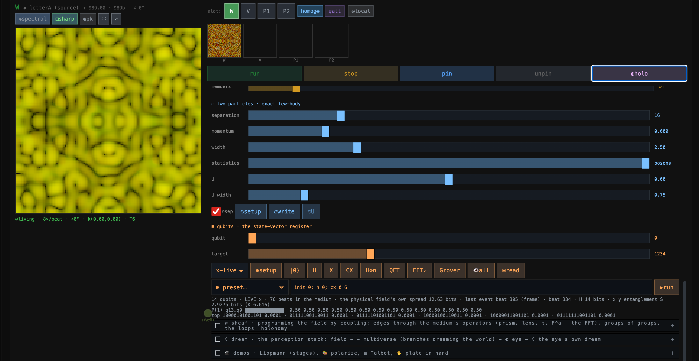

## Krestianstvo Abstract Holographic computer medium: UPDATE (10/2026)

(**Commit 9dc364f**: coherent sheaves, clock instanton tunnelling, quantum phase slip, qubit circuits, spectrometer, twin physical unclonable hash function, fractional Fourier lens, multiverse)

The following updates succesfully bridged the gap between discrete digital networking and continuous analog physics in form of true detrminstic, sycnhronised, replicated wave medium.

**The shift: time → operator → light → structure → laser → time**

Krestianstvo medium used to be a field with a pinned symbol, an eye that read it, and a few couplings. Now light writes structure into the medium, the structure guides and lases the light, the medium's own operators do the optics, colour and sound are measured as a spectrometer and an ear measure them, and slots couple as a sheaf whose edges are the medium's operators. Every peer computes the same field deterministically and localy. 

## 1. Laser = Hologram (duality)

Krestianstvo treats a laser and a hologram as dual manifestations of the same wave propagation and scattering equations. Active gain, standing wave cavity modes, Bragg/Lippmann color selectivity, and holographic recording/reconstruction share the exact same leapfrog propagator and saturable refractive index equations.
Deeply faithful to wave optics. Optically, a hologram is simply a frozen laser cavity mode, and a laser is an active holographic interferometer. By formulating both under the same operator, the code correctly models how a recorded refractive index guide acts as a grating that regenerates the phase-conjugated wave when illuminated by the reference beam.

## 2. Self-Pinning ("Pin Done by Field Itself")

Instead of anchoring the field to an external rigid coordinate template, the reference phase and frequency are derived dynamically from the field's own internal projection. The instantaneous frequency is computed directly from the field's spatial envelope and operator eigenvalue integration.
That is the most rigorous self-consistent mechanism in the architecture. Traditional optical traps and phase-locks rely on an external reference clock or master oscillator. By making the phase an emergent functional of the optical field's spatial overlap, the system achieves true self-consistency (akin to Hartree-Fock or nonlinear self-trapped eigenmodes). The phase tracks the field's own collective coordinate rather than imposing an artificial external clock.

## 2. Coherent Sheaves & The Multiverse

Modeled via cellular sheaves on graphs where vertices represent slots (worldlines) and stalks represent the continuum field. 
Slots are stalks; an edge is a coupling through a medium operator (a prism, a lens, the propagator). Each component steps as one field, exactly where the operators allow. Loops carry a flux (π is frustration) and an operator holonomy (the light comes back transformed); groups are vertices at the next level.

Rather than treating multi-slot systems as isolated chat rooms or separate components, Krestianstvo implements true connection Laplacians, gauge tracking, holonomy calculations. The "multiverse" is structured hierarchically through groups of groups, allowing collective modes to be pulled back onto member pairs faithfully.
The perception stack: field → ⇀ multiverse branches (slots dreaming the world through an operator) → the eye → the eye's own dream.

Arrows, the multiverse and the dream.

An arrow ⇀ is an observation. The target reads the source, the source does not feel it. Through the propagator continued into complex time, an arrow becomes a softened, lossy view. The multiverse is the medium dreaming: each branch is a full slot that observes a world through an arrow with an operator. A branch can be a world in turn. Two branches with the same prior, operator and medium are identical. The eye's dream  is different: it runs in the eye's own medium on what the eye already read. It is perception's activity, not a claim about the world.

In the context of the medium's native cellular sheaf and quantum graph architecture, pointwise coupling refers to interactions, constraints, or transformations that are evaluated locally at individual nodes (vertices and their associated stalks) rather than globally across the entire network at once. Replacing matrix exponentials with the native differential physics of the medium transforms holographic medium from a heavy linear-algebra simulator into a true analog-style wave medium. It trades away large, unphysical time-steps for blazing-fast, localized spatial updates, opening the door to complex, non-linear topological phenomena that heavy matrix math obscures.

## 3. Clock Instanton Tunnelling & Quantum Phase Slip

The field is a synthetic macroscopic wavefunction. First-quantised effects are native; second-quantised ones exist only when declared.
Avialable phenomenons: Tunnelling in a double well, Quantum phase slips (pendulum), Two particles in one slot, Qubit register, Zero-point fluctuations, Measurement, temperature (Langevin bath).

Built directly into the medium's potential and nonlinear operators using double-well structures (wells), periodic cosine potentials (cosine), weak links/constrictions (junction), and saturable Kerr nonlinearity.

Clock tunnelling through the ridge means the medium's time skips a tick by quantum uncertainty rather than by being knocked over the top.

Rather than simulating abstract probabilities, the Krestianstvo medium treats the wavefunction as a real physical field. Quantum phase slips and barrier tunnelling emerge naturally from the discrete symplectic leapfrog integration of the operator coupled with local phase variations and the non-Hermitian gain/loss balances. All is computed deterministically local by peers.

## 4. Qubit Circuits

Handled via the embedded quantum circuit executor supporting standard gate sets (Pauli matrices, Hadamard, phase gates, CNOT, Toffoli, SWAP, QFT, Grover diffusion, and measurements) mapped directly to binary register spaces.
This allows quantum algorithmic primitives to run natively alongside continuous wave holography, treating qubits as indexed projections of the underlying discrete Hilbert space.

## 5. Twin Physical Unclonable Hash Function (PUF)

Implemented by utilizing seeded random index screens (optical glass plates) and speckle pattern propagation to generate 256-bit cryptographic fingerprints from field intensities.
Because the propagation engine is entirely deterministic and shares identical seed entropy across peers, distinct nodes independently compute the exact same "twin" cryptographic hash from virtual physical scattering—yielding a robust PUF signature resistant to tampering.

## 6. Fractional Fourier Lens

Integrated into the operator matrix and coupling definitions via fractional Fourier transformations (frft), moving smoothly between spatial and momentum representations (fractional turns in phase space).
Implemented as a clean parameter-driven unitary group rather than a visual approximation, ensuring mathematical reversibility and rigorous optical coherence.

## 7. Spectrometer

Decomposes the field into radial wave-number bands, calculating energy-weighted mean values and coherent versus turbulent energy fractions.
It replicates the physical diagnostic capability of optical spectrometers, allowing agents and observers to inspect the exact spectral health and knee-frequency dynamics of the medium in real time.
In a virtual physical field medium of abstract holographic computer, a spectrometer functions as a translation bridge between raw mathematical wave mechanics and sensory perception. Because the underlying medium operates on continuous wave equations, phase fields, and mixed-radix spatial grids, the spectrometer acts as an active diagnostic transducer that converts abstract spatial frequencies into intuitive analogs: pitch (auditory frequency) and color (optical spectral distribution).

### Extracting "Pitch" (Acoustic Mapping)

To translate wave dynamics into auditory pitch, the spectrometer computes the energy-weighted mean wave number. As nonlinear interactions, phase slips, or standing wave patterns evolve in the virtual medium, the centroid shifts up or down. By mapping directly to an audio oscillator frequency (e.g., scaling into audible Hertz ranges), observers can "hear" the mechanical tension, resonant modes, and compression waves of the virtual field in real time. High values produce high-pitched tones, while dense, low-frequency wave packets produce deep sub-bass hums.

### Extracting "Color" (Optical Spectral Mapping)

Just as an optical spectrometer separates white light into a rainbow based on wavelength, the virtual spectrometer divides the radial wave-number bands into discrete color channels (such as red, green, and blue components). The relative energy fraction residing in each band dictates the RGB intensity tuple. By continuously sampling these metrics, the spectrometer turns the invisible physics of the holographic manifold into a fully immersive, multi-sensory diagnostic environment.

## 8. Synthesising spectral dimension

Normally, calculating fractal dispersion requires massive, irregular mesh structures or heavy CPU-based graph traversal. The Krestianstvo medium achieves this on a regular 2D texture grid by using an Fractal time generator ring kernel that mathematically emulates multi-scale fractal connectivity.
Inverting the Paradigm: Instead of using spectral dimension merely to analyze a chaotic physical material after the fact, the Krestianstvo medium synthesizes it. It uses the dispersion shift as a design tool to give a flat GPU canvas the computational information density of a 3D space.

The Krestianstvo medium proves that there is no need in a 3D hardware container to generate 3D physics. By structuring how signals connect across scales using an Fractal time generator kernel, a fundamentally 2D substrate naturally births a 3-dimensional operational space at the scales where wave interference matters most. It suggests that our experience of "3D space" is simply the stable, macroscopic operating regime of a multi-scale harmonic cascade.

That describes one of the most powerful and unusual properties of the Krestianstvo medium: its spatial geometry is not fixed to a rigid integer dimension (like a flat 2D grid or a 3D box), but dynamically morphs depending on the scale at which you observe it. Instead of treating space as uniform, the medium behaves like a fractal substrate, expanding or contracting its effective dimensionality across different wavelengths.